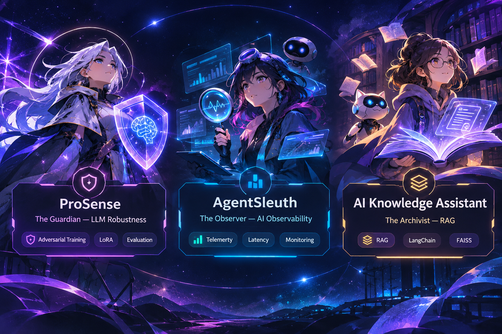
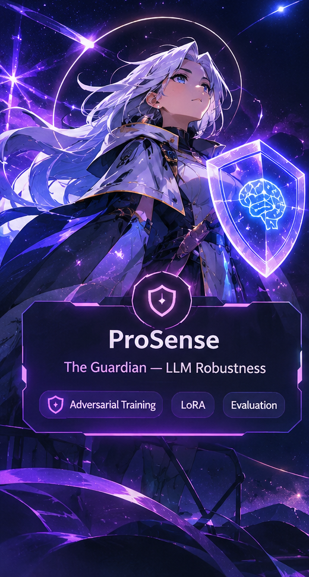
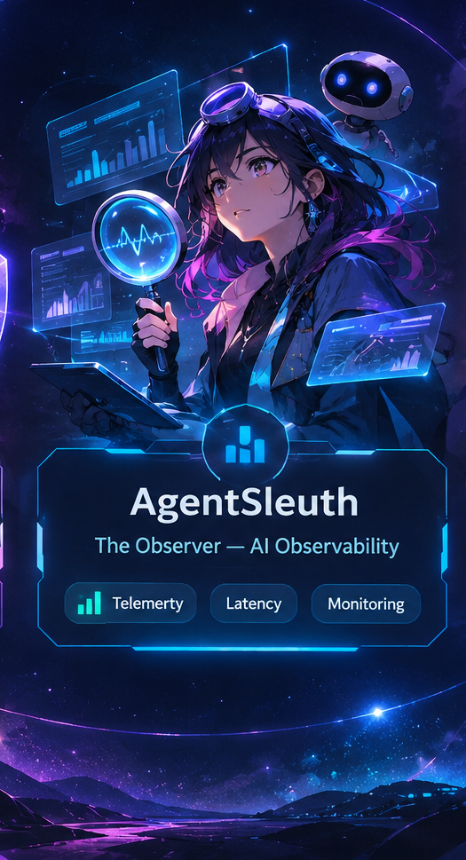
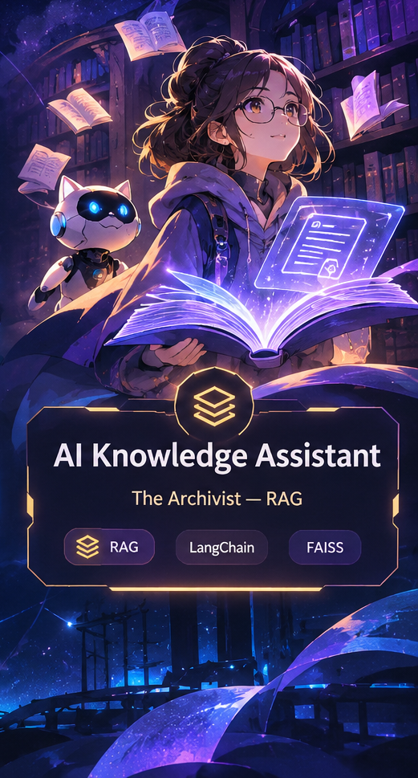

# 👋 Hey, I'm Vasudha Pasumarthy

### AI/ML Research · Engineering · Experiments

**I’m not here just to use intelligent systems. I’m here to understand them, challenge them, and build what comes next.**

[Website](https://vasudha-pasumarthy-9yi53wm.greta.sh/) ·
[LinkedIn](https://www.linkedin.com/in/vasudha-pasumarthy-141790213) ·
[Blog](https://medium.com/@vasudhap2) ·
[Email](mailto:vasudhap2@gmail.com)

---

## 🧪 Welcome to my experiment log

I'm an AI/ML researcher and engineer based in Sandy, Utah. I work across LLM fine-tuning, retrieval-augmented systems, model evaluation, observability, and data infrastructure.

What interests me most is the space between **what a model can do in a demo and what it can reliably do in the real world**.

I like exploring questions, building prototypes, measuring what happens, and following unexpected results. Not every experiment needs to become a product. Every good experiment should teach me something.

---

## 🌌 Experiments I've Put Into the World

Each project has a character in this little research universe. Select a project to explore its code, research, or live site.

<table>
<tr>
<td width="33%" align="center" valign="top">

### 🛡️ ProSense
**The Guardian — LLM Robustness**

Exploring how adversarial feedback affects language models, and how fine-tuning can improve robustness.

- Mistral-7B
- LoRA fine-tuning
- Adversarial evaluation

[📄 Read the research paper](https://link.springer.com/chapter/10.1007/978-3-032-08649-5_20)

</td>
<td width="33%" align="center" valign="top">

### 🛰️ AgentSleuth
**The Observer — AI Observability**

An LLM observability platform that captures request-level telemetry and turns model interactions into measurable performance insights.

- Response latency
- Input and output tokens
- PostgreSQL telemetry pipeline

[🔗 Explore the repository](https://github.com/iamimpeccable/AgentSleuth---LLM-Observability-Dashboard)

</td>
<td width="33%" align="center" valign="top">

### 📚 AI Knowledge Assistant
**The Archivist — RAG**

A document-grounded assistant that chunks and embeds local documents, retrieves relevant context, and generates grounded answers.

- Gemini + LangChain
- FAISS vector search
- 20-question retrieval test

[🔗 Explore the repository](https://github.com/iamimpeccable/AI-Knowledge-Assistant)

</td>
</tr>
</table>

---

## ⚙️ Building for the real world

### TrueCaptcha — Co-Founder

Built and helped scale an AI SaaS CAPTCHA-solving platform with full-stack architecture and distributed processing.

- Scaled to **900K+ API requests/day** (1M peak) across 330+ users.
- Generated approximately **$20K+ revenue**.
- Reduced latency from approximately **7 seconds to 1 second** using caching and asynchronous pipelines.

[🌐 Visit TrueCaptcha](https://truecaptcha.org)

---

## 🧭 How I approach the work

> I'm not collecting technologies to decorate a résumé. I'm here to ask better questions, run experiments, understand failure, and make ideas work outside the demo.

| Research vector | Questions I like exploring |
|---|---|
| **Model behavior** | Fine-tuning, robustness, evaluation, hallucinations, and failure modes |
| **Retrieval & agents** | RAG quality, chunking, multi-agent pipelines, and grounded outputs |
| **AI infrastructure** | Observability, telemetry, data systems, and performance |
| **Real-world scale** | Latency, concurrency, reliability, and operational impact |

---

## 🧰 Tools in my workshop

**Languages & data:** Python · SQL · R · Pandas · NumPy · PostgreSQL · MySQL · MongoDB

**AI/ML:** PyTorch · Transformers · LLM fine-tuning · LoRA · NLP · Computer Vision · RAG · LangChain · FAISS

**Engineering:** FastAPI · REST APIs · Streamlit · Docker · Git

**Cloud & analytics:** AWS · Google Cloud · Power BI · Tableau

---

## 💼 Experience

- **Research Assistant** — University of Southern Mississippi · Sep 2025 – May 2026
- **Graduate Research Assistant** — University of Southern Mississippi · Sep – Dec 2023
- **Software Development Intern** — Lampro Tech

---

## 📊 GitHub activity

---

## ✍️ Outside the repositories

I also share what I'm learning and thinking about:

- [Website](https://vasudha-pasumarthy-9yi53wm.greta.sh/)
- [LinkedIn](https://www.linkedin.com/in/vasudha-pasumarthy-141790213)
- [Medium](https://medium.com/@vasudhap2)

---

### Currently curious. Always building.

**Open to AI/ML engineering, data engineering, and research opportunities.**

📍 Sandy, Utah · ✉️ [vasudhap2@gmail.com](mailto:vasudhap2@gmail.com)

